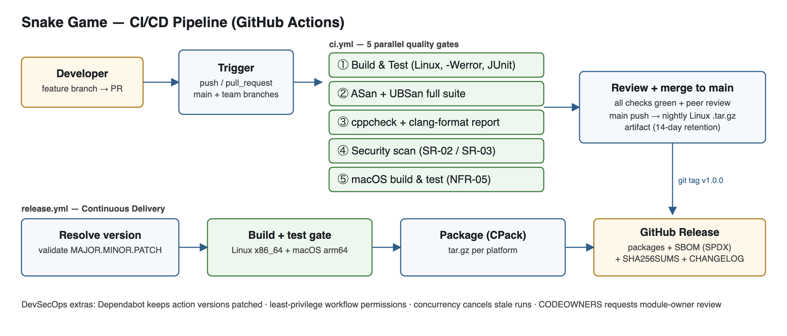

# CI/CD Pipeline — Snake Game



## Continuous Integration — `.github/workflows/ci.yml`
Runs on every push and pull request to `main`, `charan`, `vrunda`, `ved`, `tushar` (and on demand).
The five jobs run **in parallel**; a PR should only be merged when all required jobs are green.

| Job | What it does | Requirement / test it evidences |
|---|---|---|
| **Build & Test (Ubuntu 22.04)** | Installs SFML 2, builds with `-Wall -Wextra -Wpedantic -Werror`, runs all 73 tests with CTest under `xvfb`, uploads a JUnit XML report. On `main` it also packages a nightly `.tar.gz`. | FR-01…FR-17, NFR-05, NFR-06 |
| **ASan + UBSan** | Debug build with AddressSanitizer + UndefinedBehaviorSanitizer + leak detection; any memory error fails the build. | TC-07, TC-13 sanitizer sub-steps; SR-05 |
| **Static Analysis** | `cppcheck` (warning/performance/portability — blocking), cppcheck style report and `clang-format` coding-standard report (advisory). | NFR-04, coding standards |
| **Security Scan** | `scripts/security_scan.sh` fails if the source uses `system`, `popen`, `exec*`, `fork`, `CreateProcess`, file writes/deletes, or loads any file other than the bundled font. | TC-14 → SR-02, SR-03 |
| **Build & Test (macOS)** | Builds and tests with Homebrew `sfml@2` on Apple Silicon. | NFR-05 portability |

Design choices worth knowing:
- `permissions: contents: read` — least privilege for the token.
- `concurrency` cancels superseded runs on the same branch (faster feedback, fewer wasted minutes).
- Ubuntu is pinned to **22.04** (Tushar, PR #28, commit `b64f1db`) so the runner keeps an SFML 2
  package (2.5.1). The code uses the SFML 2 API; SFML 3 has breaking changes. Pinning the runner
  makes the build environment reproducible instead of changing whenever `ubuntu-latest` moves.
- GoogleTest is pinned to an exact commit (v1.17.0) — reproducible builds.

## Continuous Delivery — `.github/workflows/release.yml`
Triggered by pushing a tag like `v1.0.0` (or manually, which creates a *draft* release).

1. **Resolve version** — rejects tags that are not `MAJOR.MINOR.PATCH`.
2. **Build + test gate** on Linux x86_64 and macOS arm64 — nothing ships if a test fails.
3. **Package** with CPack (`SnakeGame-<ver>-<platform>.tar.gz`): executable + `assets/` + README.
4. **Publish** — SPDX **SBOM** (anchore/syft), `SHA256SUMS.txt`, release notes from `CHANGELOG.md`,
   uploaded as a GitHub Release.

### How to cut the release
```sh
git checkout main && git pull
git tag v1.0.0
git push origin v1.0.0
```
Then watch **Actions → Release**; the release appears under **Releases**.

> Packages still need SFML 2 runtime libraries installed on the target machine
> (`sudo apt install libsfml-dev` / `brew install sfml@2`). Windows packaging is out of scope;
> Windows users build from source as described in the README.

## DevSecOps
- Dependabot opens PRs when action versions have security/feature updates.
- SBOM + checksums give consumers supply-chain transparency and integrity verification.
- Sanitizers, static analysis and the forbidden-API scan "shift security left" into every PR.

## Running the same checks locally
```sh
# strict build + tests
cmake -S . -B build -DSNAKE_ENABLE_WARNINGS=ON -DSNAKE_WARNINGS_AS_ERRORS=ON
cmake --build build && ctest --test-dir build --output-on-failure
# sanitizers
cmake -S . -B build-asan -DCMAKE_BUILD_TYPE=Debug -DSNAKE_ENABLE_SANITIZERS=ON
cmake --build build-asan && ctest --test-dir build-asan --output-on-failure
# static analysis + security scan
cppcheck --enable=warning,performance,portability --std=c++17 -I src src
./scripts/security_scan.sh
# package
cd build && cpack -G TGZ
```
